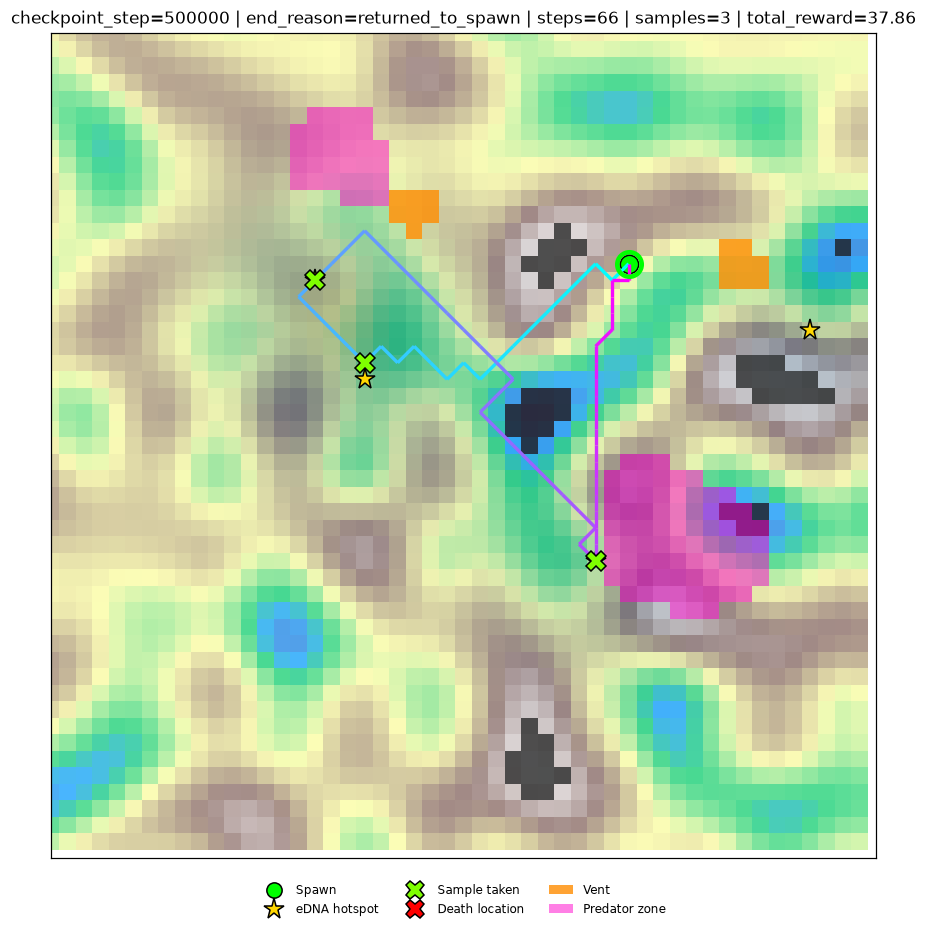
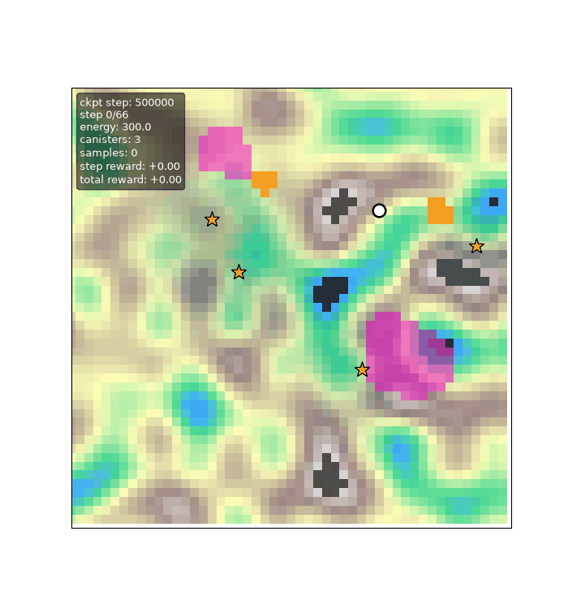

# Underwater Robot RL: Seafloor eDNA Survey Agent

A reinforcement learning agent, trained from scratch with PPO, that controls a simulated underwater robot searching a seafloor for eDNA (environmental DNA) samples. eDNA is a real marine-biology technique for detecting which species are present without ever seeing the organism.

The robot has to find hotspots under an energy budget, stay clear of lethal vents and predator zones, and **make it back to its starting point with what it collected**. That makes it a round-trip planning problem, not just a search problem.

## Results

Final checkpoint: 500k steps per environment, 8 environments, 4M environment steps in total, about 2-3 hours on a 12-core CPU (depending on what else the machine is doing). Evaluated on **200 episodes per row on seeds that were never used for debugging**, with all 3 canisters and no forced return starts. "Sampled" draws actions from the policy; "greedy" always takes the most likely action. Intervals are 95% Wilson intervals on the return rate.

| Hotspot distance limit | Mode | Returned to spawn | Out of energy | Predator deaths | Samples (of 3) | Avg reward |
|---|---|---|---|---|---|---|
| 13 tiles | sampled | 199 / 200 (99.5%, 97-100%) | 1 | 0 | 2.95 | +38.7 |
| 13 tiles | greedy | 188 / 200 (94.0%, 90-97%) | 11 | 1 | 2.81 | +35.4 |
| 30 tiles (training maximum) | sampled | 194 / 200 (97.0%, 94-99%) | 4 | 2 | 2.85 | +37.8 |
| 30 tiles | greedy | 180 / 200 (90.0%, 85-93%) | 18 | 2 | 2.71 | +34.4 |
| any distance (≥ 8 tiles) | sampled | 196 / 200 (98.0%, 95-99%) | 3 | 1 | 2.88 | +39.1 |
| any distance (≥ 8 tiles) | greedy | 179 / 200 (89.5%, 84-93%) | 20 | 1 | 2.66 | +34.3 |

No vent deaths occurred in these 1,200 evaluation episodes.

How to read these numbers:

- **One training run, one seed.** I have no estimate of run-to-run variation. The intervals only describe evaluation noise on this one checkpoint.
- **Greedy is a few points below sampled** (about 5-8 points; the intervals don't overlap at 13 and "any distance"). It no longer collapses, but it is not as good, and it looks slightly worse at longer distances (more out-of-energy endings).
- **The task is easier than the first version of this project.** Sampling works within 1 tile of a hotspot, and the action mask removes moves that do nothing (see below). The stricter earlier version is reported next.
- **The environment tells the robot when to go home** (see "How it works"). It still has to navigate back and avoid hazards, but the timing of the decision is partly handed over.
- The agent collects 2.7-2.95 of 3 canisters, so there is little room left on this metric.

### Earlier, stricter version (exact-cell sampling, vent-only mask)

In the first version a sample only counted from the hotspot's exact cell, and the mask only blocked vents. Evaluated on 50 episodes per row, sampled policy:

| Hotspot distance limit | Returned to spawn | Samples (of 3) | Avg reward |
|---|---|---|---|
| 13 tiles | 41 / 50 | 1.88 | +18.9 |
| 20 tiles | 37 / 50 | 1.84 | +17.1 |
| 30 tiles | 41 / 50 | 1.80 | +19.8 |
| any distance | 36 / 50 | 1.76 | +17.9 |

The greedy policy of that version returned only 14-22% of the time and sampled about 0.3 per episode. That evaluation used 50 seeds that I also used while diagnosing problems, so treat it as rough. These numbers are not comparable to the table above: they come from a harder task and a different mask.

## Example

One evaluated episode from the earlier exact-cell version (seed 20, 3 canisters). I picked it from 20 seeds because the agent collects all 3 samples and returns home; a typical episode of that version collected about 1.8.





## How it works

**Environment** (`scripts/environment.py`): a procedurally generated 50×50 grid with Perlin-noise terrain, 3-5 eDNA hotspots per episode (Gaussian concentration fields), thermal vents (instant death, placed near hotspots to create risk/reward), predator zones (0.5% attack chance per step inside), 3 sample canisters, and an energy budget of 300 that has to cover the full round trip. The agent chooses from 9 actions: 8 moves and SAMPLE. SAMPLE collects from an unsampled hotspot within 1 tile and pays `concentration at the robot's cell × 10`.

**Observation** (agent-centered):

- a 49×49 window centered on the robot (zero-padded at the map edge) with 6 channels: elevation, eDNA concentration, vent mask, predator mask, sampled-hotspot mask, and a **home beacon** (a wide Gaussian around spawn)
- 5 scalars: energy fraction, canister fraction, spawn offset (row, column), and an energy margin `(energy − 1.2 × distance_home) / max_energy`
- the home beacon is only shown when going home makes sense: all canisters used, or at least one sample taken and `energy < 1.5 × distance_home + 20`. Otherwise the channel is zero.

**Algorithm**: Proximal Policy Optimization written from scratch in PyTorch (no RL library): clipped surrogate objective, GAE (λ = 0.95), separate actor and critic networks (each a 3-layer CNN plus a small scalar embedding), entropy regularisation (0.01 → 0.001), learning rate annealed 3e-4 → 3e-5, gradient clipping applied separately to actor and critic. Rollouts come from 8 parallel worker processes (spawn-based, so it runs on Windows).

**Action mask**: an action is masked out if it would do nothing or kill the robot:

- moves onto a vent cell
- moves off the map or into impassable terrain (these are no-ops that still cost energy)
- SAMPLE, unless the robot has a canister and an unsampled hotspot is within 1 tile

The mask is stored with every transition and replayed during the PPO update. Predator zones are not masked on purpose; they are a risk to trade off, not certain death. Offering SAMPLE only where it can succeed is a simplification: a real sampler would not be told when it is in range.

**Training distribution**:

- Hotspot distance follows a curriculum: each episode draws its maximum distance from spawn uniformly between 10 and a ceiling that grows over the whole run (quadratically) to 30 tiles.
- 30% of episodes start in the **return phase** (agent already out on the map, no canisters, partly used tank). Without this, the return trip was almost never practised and training stalled at about 5% returns.
- Canister count is random (1-3) in training and fixed at 3 in evaluation.

Full reward details are in [`REWARDS.md`](./REWARDS.md).

## What went wrong along the way

The interesting part of this project was diagnosing why training kept failing and fixing root causes instead of tuning hyperparameters.

- **Reward hacking.** The agent earned most of the "mission complete" reward by stepping out of spawn and straight back in. Fixed by making the return pay mostly through samples and requiring at least one sample.
- **A silent shaping bug.** The shaping discount was hardcoded separately from the agent's gamma; once they drifted, the agent could bank reward by loitering near a target. Fixed with a single source for gamma.
- **Policy collapse.** Entropy either stayed near maximum forever or collapsed onto a useless fixed behaviour, depending on the schedule.
- **Catastrophic forgetting under a one-way curriculum.** Fixed by drawing each episode's difficulty from a range instead of a single ramping value.
- **The agent couldn't navigate (the biggest one).** Every run plateaued at random-level sampling. The cause was the observation: the robot's own position was only two scalars (later a single pixel in its own channel), and a CNN followed by a fully connected layer is very slow to learn "where is the blob relative to me" from that. A scripted expert showed the task was easy. In a behaviour-cloning test with the same network and data, the agent-centered view reached about 72% accuracy and 0.76 samples per episode after 60 epochs, against about 31% and 0.0 for the global view. Switching training to an agent-centered window fixed the plateau.
- **Parking.** Once it could sample, the agent learned to stop and wait out the timeout instead of coming home, because idling cost almost nothing. Fixed by charging a full move's energy for any step that doesn't move the agent.
- **Never learning to return.** The return trip was rare in training, so it wasn't learned (0 of 40 successes when I placed the agent on a hotspot with no canisters). Fixed by starting 30% of episodes in the return phase, plus the conditional home beacon. This took returns from about 5% to about 80%.
- **Exact-cell sampling and a greedy policy that looped.** The probability of pressing SAMPLE was about 0.54, 0.56 and 0.49 on the hotspot cell, one tile away and two tiles away: the agent could not tell the exact cell, so it hovered next to hotspots pressing SAMPLE about half the time. The sampled policy got away with it; the greedy one pressed SAMPLE (or a blocked move) forever. Allowing sampling within 1 tile and masking actions that do nothing fixed most of it: on the same checkpoint, greedy returns went from 58% to 92% on a 50-episode check.
- **A misleading evaluation.** An early evaluation script didn't apply the vent mask and showed 35% vent deaths; the training code was fine.

## Limitations

- Single run and seed; the numbers above are not averaged over training runs.
- The greedy policy is a few points worse than the sampled one.
- The environment decides when to show the home beacon, and offers SAMPLE only when it can succeed.
- Sampling works within 1 tile, which makes the task easier than exact-cell sampling.
- Vent deaths of about 1-4% appeared in some early training logs despite the mask; I never found the cause. None occurred in the 1,200 evaluation episodes above.
- 2D grid world only; no physics or currents. A 3D version is a possible next step.
- The 30-tile curriculum maximum was exceeded only at evaluation ("any distance").
- The example trajectory comes from the earlier version of the agent.

## Setup

```bash
python -m venv .venv
source .venv/bin/activate        # Windows: .venv\Scripts\activate
pip install -r requirements.txt
```

The pinned `torch` is enough for CPU training, which is what this project uses (the model is small and the time goes into the environment).

## Usage

Run everything from the `scripts/` folder.

Train from scratch:
```bash
cd scripts
python train.py
python train.py --fast-test     # shorter proxy run
```

Evaluate a checkpoint (arguments: checkpoint, hotspot distance limit, optional `greedy`):
```bash
python eval_final.py checkpoints/ppo_step500000_final.pt 30
python eval_final.py checkpoints/ppo_step500000_final.pt 30 greedy
```

Watch one episode (writes a trajectory image and a GIF to `rollout_viz/`):
```bash
python visualize_rollout.py --checkpoint checkpoints/ppo_step500000_final.pt --seed 7
```

Run the scripted baseline that routes around obstacles and vents:
```bash
python test_survivability.py
```

Checkpoints are not stored in the repository.

## Repository layout

- `scripts/environment.py`: the environment, reward, observation and action mask
- `scripts/terrain_generator.py`, `object_placement.py`, `hazards.py`: procedural generation
- `scripts/networks.py`, `ppo.py`, `buffer.py`: actor-critic network and PPO
- `scripts/vec_env.py`: parallel environments
- `scripts/train.py`: training loop, curriculum and schedules
- `scripts/eval_final.py`, `visualize_rollout.py`, `visualize_environment.py`, `test_survivability.py`: evaluation and diagnostics
- `REWARDS.md`: reward and energy reference
- `images/`: example trajectory and run animation